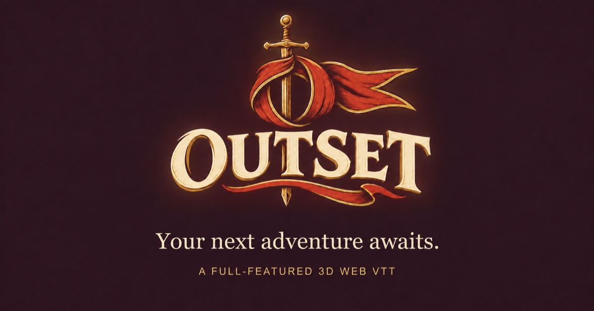

  

<h3 align="center">Manifest your world. Experience it together.</h3>

  Outset is a browser-based 3D virtual tabletop. Create characters and bring your maps to a shared 3D tabletop. Run D&amp;D encounters with your group in the browser.

  <a href="https://outset-vtt.gg/"><b>Website</b></a> ·
  <a href="https://app.outset-vtt.gg/">Open Outset</a> ·
  <a href="https://discord.gg/mAPuKfcr3T">Discord</a> ·
  <a href="https://www.youtube.com/@PlayOutset">YouTube</a> ·
  <a href="https://x.com/playoutset">X</a> ·
  <a href="https://www.reddit.com/user/play_outset/">Reddit</a>

## Start here

| I want to… | Go to |
| --- | --- |
| Play or run a game | [outset-vtt.gg](https://outset-vtt.gg/). Outset is in private beta, so request access there. |
| Make my own monsters, items, spells, species, backgrounds or feats | [Compendium authoring guide](https://github.com/outset-vtt/compendium-authoring-guide), starting with the [Goblin Raider quickstart](https://github.com/outset-vtt/compendium-authoring-guide/blob/main/guides/quickstart.md) |
| Have an AI agent build content, scenes or assets with me | [Outset Creator agent plugins](https://github.com/outset-vtt/agent-plugins) |
| Ask a question or share what I made | [Discord](https://discord.gg/mAPuKfcr3T) |

## Repositories

- **[compendium-authoring-guide](https://github.com/outset-vtt/compendium-authoring-guide)**: guides, Markdown templates and original examples for custom content on Outset's D&amp;D SRD 5.2.1 base.
- **[agent-plugins](https://github.com/outset-vtt/agent-plugins)**: Outset Creator skills for Codex, Claude Code and Claude/Cowork, covering compendiums, monsters, scenes and reusable assets.

Both are MIT licensed. Found a problem with a guide or plugin? Open an issue in that repository.
